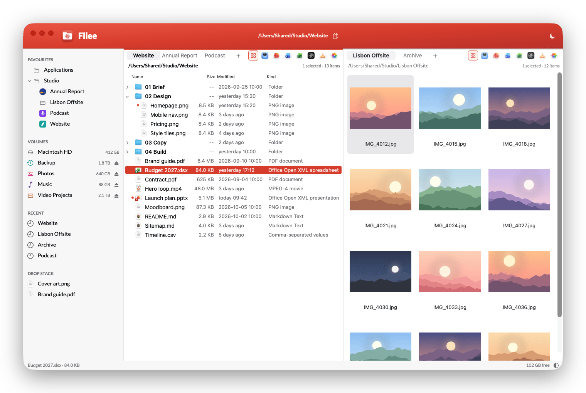
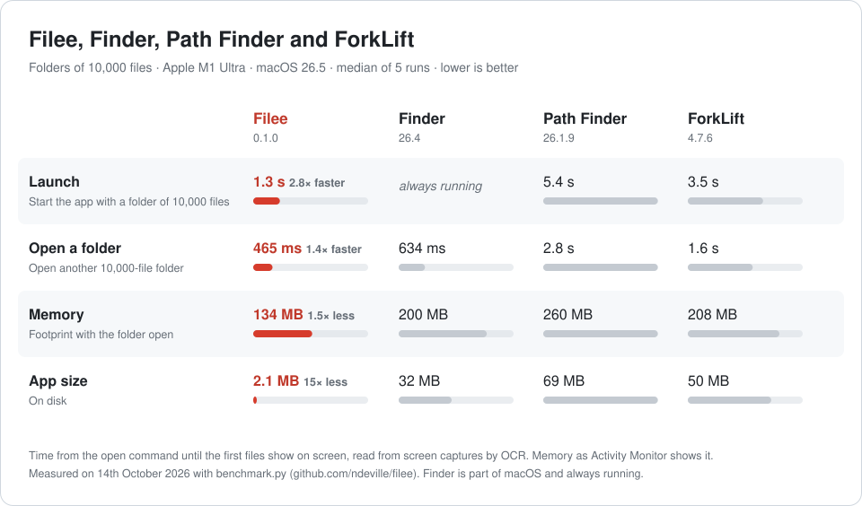
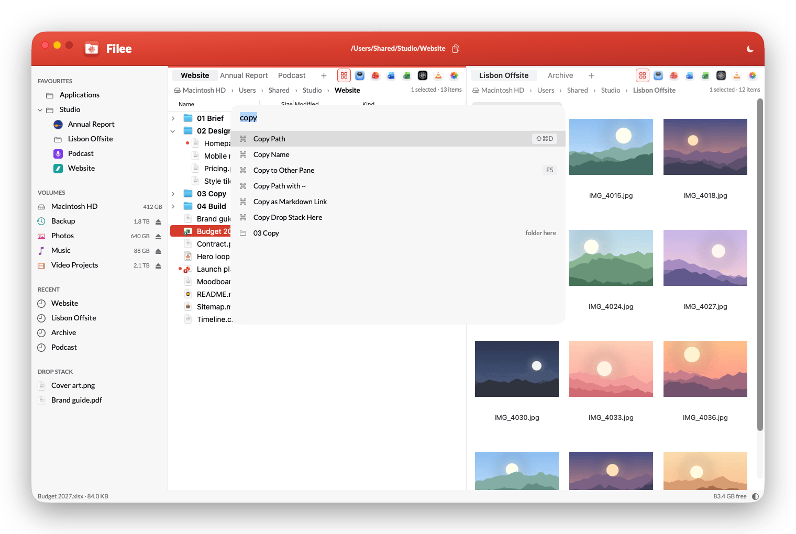
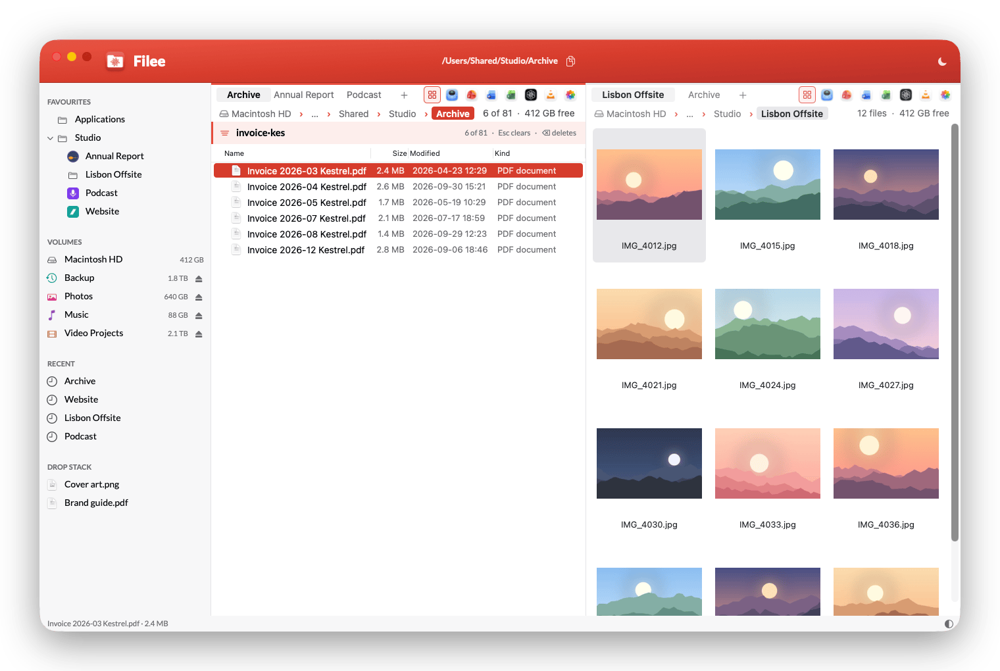
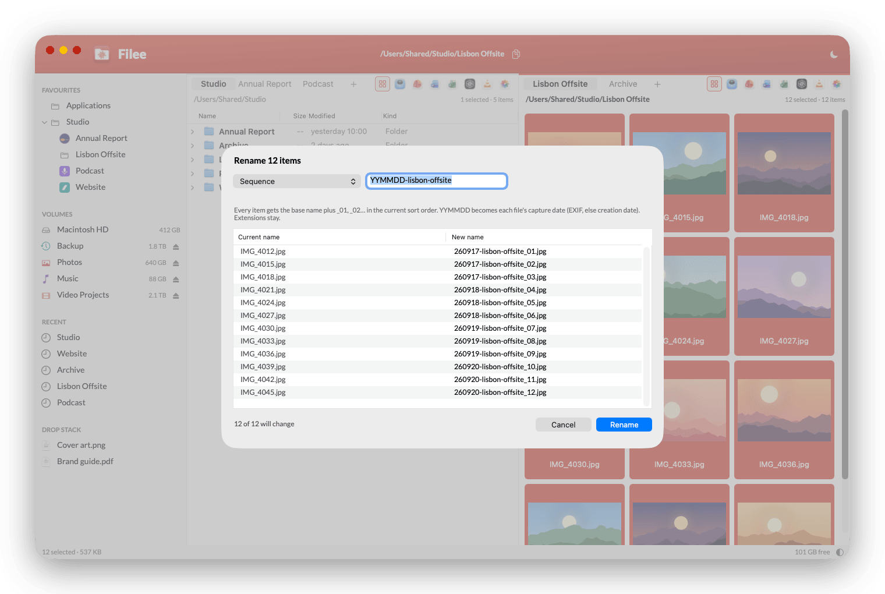
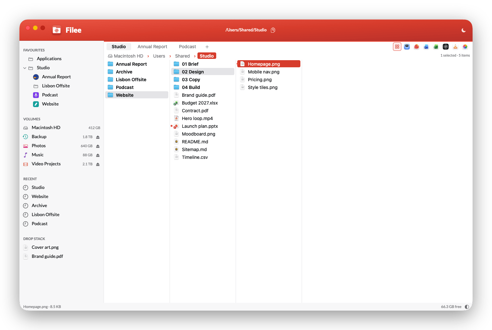
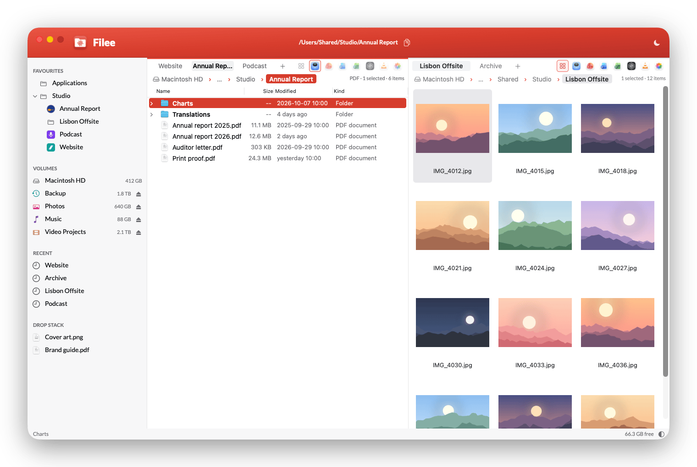
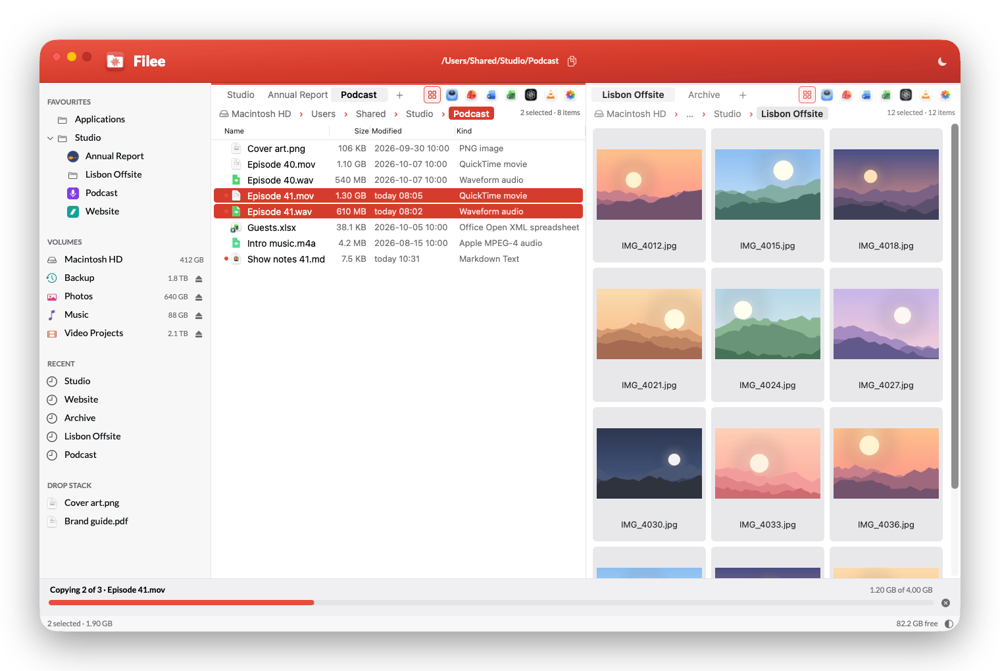

<div align="center">


<h1>Filee</h1>

<p><strong>A fast, keyboard-first file manager for macOS.</strong><br>
2 panes, tabs, a command palette and type-to-filter, in a native app of 2 MB.</p>

<p>


<a href="LICENSE"></a>
</p>

<p>
<a href="#features">Features</a> ·
<a href="#screenshots">Screenshots</a> ·
<a href="#build-and-install">Build and install</a> ·
<a href="#daily-keys">Daily keys</a> ·
<a href="#configuration">Configuration</a> ·
<a href="https://notes.nicolasdeville.com/nicai/filee/">The story behind Filee</a>
</p>

<picture>
  <source media="(prefers-color-scheme: dark)" srcset="assets/screenshots/hero-dark.png">
  
</picture>

</div>

## Why Filee

I built Filee with Claude Code to replace Path Finder, and I use it every day. It's for people who keep their hands on the keyboard and want a file manager that opens before they finish the thought.

<picture>
  <source media="(prefers-color-scheme: dark)" srcset="assets/benchmark/benchmark-dark.svg">
  
</picture>

`benchmark.py` measured these numbers. It opens each app on 2 folders of 10,000 files, captures the screen and reads the frames with OCR to find the moment the first files show. It never touches the apps it measures. To measure on your Mac, run `python3 benchmark.py`.

Inside Filee, listing 10,000 files takes 66 to 83 ms, and the filter takes 7 to 8 ms per keystroke.

Filee reads folders with `getattrlistbulk`, copies with `copyfile` (an instant clone on APFS) and draws with AppKit. It has no third-party code, no network access and no telemetry.

This is personal software. It does what I need on my Mac. I don't offer support, and I read issues and pull requests when I have time. Fork it and make it yours.

## Features

### Browse

- **2 panes, each with its own tabs, history and view.** ⌘1 and ⌘2 switch between 1 and 2 panes, Tab moves between them, ⌥⌘↑ shows the enclosing folder in the other pane, and **Swap Panes** exchanges them.
- **3 views, remembered per folder:**
  - A list that expands folders in place as a tree (→ and ←, or ⌥⌘→ to expand every folder 1 level per press).
  - Miller columns, each column as wide as its content.
  - Thumbnails from 64 to 384 px. A folder that holds mostly images opens as thumbnails on the first visit.
- **Folders, files and free space under each pane's tabs,** in the file list's size: "16 folders · 63 files · 9.7 TB free".
- **Columns that fit their content** every time a folder loads. Name, size, modified and kind show by default. Date added, created, extension and item count are a right-click away.
- **Readable dates:** "today 14:05", "yesterday", "3 days ago", then `2026-10-08 14:05`.
- **New today:** a red dot marks every file added to its folder today. The dots reset at midnight.
- **A path you can click and drop on.** Each folder from your home folder down is a button: a click goes there, and a file dropped on it moves or copies there.
- **A path bar that takes anything.** ⌘O, ⌘L or ⌘G opens it, ready for a paste. It accepts quotes, `file://` URLs and shell escapes, and completes with Tab. A file path opens its folder and selects the file.
- **Folder sizes** for every folder in the listing (⌃⌘S), computed in the background.
- **Get Info** in 1 panel (⌘I): size and size on disk (folders included), files and folders inside, dates, kind, the app that opens it, where a download came from, tags, permissions, image, video and PDF details, and the free space on its volume.
- **Quick Look** with Space, invisible files with ⇧⌘I, and a second window with ⌘N.

### Find

- **Type to filter.** Type any letters and the folder narrows to the fuzzy matches, with the count and the typed text in large type. Esc clears it.
- **Command palette (⌘K).** 1 box for every command (with its key), your custom actions, favourites, jumps, recent folders and the files in the current folder. Type a path to go straight there.
- **File-type filter on each tab:** PDF, PowerPoint, Word, Excel, Markdown, video or images. Each button shows the icon of the app that opens that type on your Mac. The filter stays with the tab from folder to folder.
- **Jumps:** ⌘J and 1 letter goes to a folder you set in `settings.json`.

<p align="center">
<picture>
  <source media="(prefers-color-scheme: dark)" srcset="assets/screenshots/type-filter-zoom-dark.png">
  
</picture>
</p>

### Work with files

- **Copy, cut and paste** files from the **Edit** menu, or copy and move to the other pane with F5 and F6.
- **Fast copies:** a copy on the same APFS volume is a clone and finishes at once. Long copies show a progress panel with speed, time left and a cancel button.
- **Name conflicts** ask once: replace, keep both or skip, with "apply to all".
- **Undo and redo** (⌘Z, ⇧⌘Z, 50 steps) for rename, move, copy, new folder and Move to Trash. Undo puts a trashed file back where it was.
- **Batch rename (⌘R on several files)** with a live preview and conflicts in red:
  - Sequence: 1 base name and `_01`, `_02`, in the current sort order. `YYMMDD` in the name becomes each photo's capture date.
  - Find and replace, with regular expressions.
  - Prefix the capture date, slugify, or change the case.
  - Swaps such as `a` to `b` and `b` to `a` work, and 1 undo reverts the whole batch.
- **Zip:** compress the selection (⌃⌘C) and extract a zip next to itself.
- **Drag and drop** between panes, to and from other apps. ⌥ forces a copy, ⌘ forces a move.
- **Drop stack:** collect files from several folders (⌃⌘D), then copy or move them all to 1 place.
- **Also:** new folder, new text file, new folder with the selection, duplicate, symbolic link, Open With, Reveal in Finder, and a terminal in the current folder (⌃⌘T).
- **Safe by design:** Filee moves files to the Trash and never deletes them for good. On a network share without a Trash, it asks first, as Finder does.

### Sidebar

- **Favourites as a tree:** each favourite sits under the favourite that contains it. Fold and unfold them, add or remove the current folder with ⇧⌘F, or drag a folder in.
- **Folder logos:** put a `.filee-icon.svg` or `.filee-icon.png` in a folder and the sidebar shows that image. The logo travels with the folder through Dropbox or git.
- **Volumes** with free space, an eject button (⌘E) and their own icon and colour. `volumeIcons` gives a volume a symbol or your own image.
- **Recent folders** and the **drop stack**.
- **Keyboard all the way:** ⌥⌘F moves the keyboard to the favourites, ⇧⌥⌘F to the volumes.

### Custom actions

Run any program or script on the selection from a key, the palette or the context menu. An action sets the file types it applies to, and whether it runs in the background or in a terminal.

```json
{
  "name": "Optimise image (1920 px)",
  "command": ["/usr/bin/sips", "-Z", "1920", "{path}"],
  "extensions": ["jpg", "jpeg", "png", "heic"],
  "mode": "background",
  "each": true,
  "key": "ctrl+cmd+o"
}
```

`{path}`, `{paths}`, `{dir}`, `{name}` and `{stem}` fill in the selection. A background action shows a tick or a cross in the status bar and writes its output to a log. Commands run without a shell unless the action asks for one, and Filee never runs an action on its own.

### Look and feel

- **Light and dark** follow macOS, or pin one with ⌃⌘L.
- **Zoom** the file list, the tab names and the type icons with ⌘+ and ⌘-. ⌘0 goes back to the default size.
- **Your fonts** for the file list and the interface, set in `settings.json`.
- **Square or rounded:** `windowCorners` squares the window, `cornerRadius` sets the corners of the selection and the other highlights, from 0 to 10.
- **A global hotkey** (⌃⌥⌘F) brings Filee to the front from any app.
- **Every key is yours:** `keybindings.json` uses the VS Code format, and vim keys are 1 setting away.

## Screenshots

<table>
<tr>
<td width="50%" valign="top">
<picture>
  <source media="(prefers-color-scheme: dark)" srcset="assets/screenshots/palette-dark.png">
  
</picture>
<p align="center"><b>Command palette</b><br>⌘K finds any command, folder or file.</p>
</td>
<td width="50%" valign="top">
<picture>
  <source media="(prefers-color-scheme: dark)" srcset="assets/screenshots/filter-dark.png">
  
</picture>
<p align="center"><b>Type to filter</b><br>81 files down to 6 in 11 keystrokes.</p>
</td>
</tr>
<tr>
<td width="50%" valign="top">
<picture>
  <source media="(prefers-color-scheme: dark)" srcset="assets/screenshots/rename-dark.png">
  
</picture>
<p align="center"><b>Batch rename</b><br>Capture dates and numbers, with a live preview.</p>
</td>
<td width="50%" valign="top">
<picture>
  <source media="(prefers-color-scheme: dark)" srcset="assets/screenshots/columns-dark.png">
  
</picture>
<p align="center"><b>Columns</b><br>Miller columns, each as wide as its content.</p>
</td>
</tr>
<tr>
<td width="50%" valign="top">
<picture>
  <source media="(prefers-color-scheme: dark)" srcset="assets/screenshots/type-filter-dark.png">
  
</picture>
<p align="center"><b>File-type filter</b><br>Only the PDFs, 1 click, folders stay.</p>
</td>
<td width="50%" valign="top">
<picture>
  <source media="(prefers-color-scheme: dark)" srcset="assets/screenshots/transfer-dark.png">
  
</picture>
<p align="center"><b>Copy progress</b><br>Every copy and move, with a cancel button.</p>
</td>
</tr>
</table>

## Build and install

Filee has no download: you build it from source.

Requirements:

- macOS 26 on Apple silicon.
- Xcode 26 and [XcodeGen](https://github.com/yonaskolb/XcodeGen) (`brew install xcodegen`).
- `rsvg-convert` (`brew install librsvg`), only to rebuild the app icon after you change its SVG.

To build Filee and copy it to `/Applications`, run:

```bash
./build.sh --install
open /Applications/Filee.app
```

Without a signing identity, `build.sh` signs the app ad hoc. It runs, but macOS asks again for folder access after each rebuild. To sign with your own Developer ID certificate, set the identity before you build:

```bash
export FILEE_SIGN_IDENTITY="Developer ID Application: Your Name (TEAMID)"
```

You can also put that line in `.private/signing.env`, which git ignores.

### Make Filee the default file viewer

To make "Reveal in Finder" in other apps open Filee, run:

```bash
defaults write -g NSFileViewer com.nicolasdeville.filee
```

Filee's own **Reveal in Finder** still opens Finder: it asks Finder directly (macOS asks you once to let Filee control Finder). To go back to Finder, run `defaults delete -g NSFileViewer`. macOS doesn't let another app open folders in place of Finder, so `open <folder>` and Dock folders still open Finder windows.

## Daily keys

| Key             | Does                                 | Key           | Does                          |
| -               | -                                    | -             | -                             |
| Type letters    | Filter the folder (Esc clears)       | ⌘K            | Command palette               |
| ↩               | Open                                 | ⌘↑ / ⌘↓       | Enclosing folder / last item  |
| Tab             | Switch pane                          | ⌘O, ⌘G or ⌘L  | Type or paste a path          |
| ⌘1 / ⌘2 / F1    | Single / dual / toggle               | ⌘3 ⌘4 ⌘5      | Thumbnails / columns / list   |
| ⌘C / ⌘X / ⌘V    | Copy / cut / paste files             | F5 / F6       | Copy / move to the other pane |
| ⌘R              | Rename (several: batch rename)       | ⇧⌘N           | New folder                    |
| ⌘⌫              | Move to Trash (⌘Z puts back)         | Space         | Quick Look                    |
| ⇧⌘D             | Copy path                            | ⌃⌘T           | Terminal here                 |
| ⌘H / ⌥⌘D        | Home / Downloads                     | ⌘J then a key | Jumps from `settings.json`    |
| ⌘B              | Show or hide the sidebar             | ⌘+ / ⌘- / ⌘0  | Bigger / smaller / default    |
| ⌃⌘L             | Switch light or dark theme           | ⌃⌥⌘F          | Bring Filee to the front      |
| ⇧⌘F             | Add or remove folder in Favourites   | ⌘E            | Eject the volume              |
| ⌥⌘↑             | Enclosing folder in the other pane   |               |                               |

The full list is in **Filee > Keyboard Shortcuts…**, in the palette and in `SPEC.md` section 4.2.

## Configuration

`~/.filee/` holds 4 files. Filee reloads the first 3 when you save them.

| File               | Holds                                                                     |
| -                  | -                                                                         |
| `settings.json`    | Fonts, favourites, jumps, columns, default view, terminal, icons, corners |
| `keybindings.json` | Your keys, in the VS Code format, on top of the defaults                  |
| `actions.json`     | Custom actions                                                            |
| `state.json`       | Windows, tabs, views per folder, recent folders and the drop stack        |

## Agent interface

Agents (Claude Code, NicAI CC tasks) drive Filee through the `filee` CLI (`filee.py`; `build.sh --install` links it at `~/.local/bin/filee`). Every command takes `--json` and prints 1 JSON document; errors carry `ok: false`, `error` and `hint`, with exit codes 1 (error), 2 (usage), 3 (refused) and 4 (Filee isn't running). Writes go through `filee://` URLs opened in the background with the running copy (`open -g -a`) and a request id, and the CLI confirms each one through `~/.filee/run/live.json`, which the app rewrites on every navigation, selection and transfer. Nothing comes to the front unless the command has `--show`.

```bash
filee describe --json                 # every command, with its effect (read or write)
filee status --json                   # running, active_path, selection_count, transfers, stack
filee selection --json                # the selected paths in the active pane
filee reveal ~/Projects/report.pdf --json  # the file selected in its folder, in the active pane
filee new-tab ~/Projects --json       # a new tab in the active pane
filee stack-add a.txt b.txt --json    # add files to the drop stack
filee tabs --json                     # every pane's tabs
```

## Develop

`SPEC.md` is the specification. `CLAUDE.md` holds the layout, the rules and the AppKit lessons, for you and for Claude Code.

To run the tests, run:

```bash
cd FileeCore && swift test    # unit tests
python3 qa.py                 # end-to-end QA on fixture folders, about 1 minute
```

`qa.py` drives the real app in the background on folders it creates in `$TMPDIR/filee-qa`. It never touches your files and never takes the keyboard, so you can keep working while it runs.

To compare Filee with Finder, Path Finder and ForkLift again, run `python3 benchmark.py` (about 5 minutes, the apps open and quit while it runs). It writes the chart in `assets/benchmark/`.

To make the screenshots again, run `python3 screenshots.py`. It builds a demo folder of made-up projects in `/Users/Shared/Studio`, captures the app in light and dark, and deletes the folder. It needs Pillow and pngquant.

## Licence

MIT. See [LICENSE](LICENSE).
